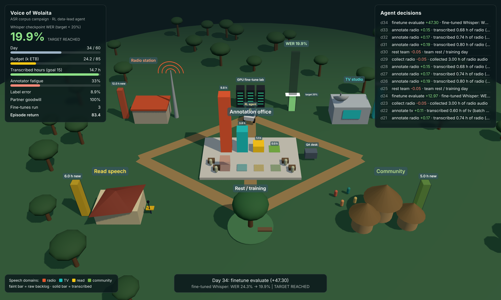

# Voice of Wolaita: RL agent for an ASR corpus campaign

Reinforcement-learning summative (ML Techniques II, ALU) by **Tedla Tesfaye Godebo**.

My capstone, *Voice of Wolaita*, fine-tunes Whisper for Wolaita, a low-resource Ethiopian
language. Its first two objectives are a sequential resource-allocation problem: collect and
transcribe at least 15 h of authentic Wolaita speech and reach **WER < 20 %** before a fixed
deadline and budget. This repo models that campaign as a custom Gymnasium environment and
compares **DQN, REINFORCE, A2C and PPO** (all implemented with **TorchRL**) on it.



## Run it

```bash
git clone <this repo> && cd tedla_godebo_rl_summative
uv sync
uv run main.py                    # best agent, three.js 3D viewer + verbose terminal log
```

Other entry points:

```bash
uv run main.py --algo ppo               # best model of a given algorithm (dqn|reinforce|a2c|ppo)
uv run main.py --profile unseen         # unseen, harder initial states
uv run main.py --random                 # untrained agent, for contrast
uv run main.py --no-gui --episodes 5    # terminal only
uv run pytest                           # environment contract tests
uv run python -m training.dqn_training --sweep            # retrain the 12 DQN configs
uv run python -m training.pg_training --algo ppo --sweep  # reinforce | a2c | ppo
uv run python -m training.analysis                        # tables, best.json, figures
uv run python -m training.baselines                       # random and rule-based reference agents
```

The viewer needs no internet (three.js is vendored in `environment/web/`). If the browser tab
does not open by itself, open the URL printed in the terminal (default `http://127.0.0.1:8765/`).

## The environment (`environment/custom_env.py`)

One step is one working day of the campaign; an episode is at most 60 days.

| | |
|---|---|
| **Actions (11, discrete)** | collect audio from radio / TV / read-speech session / community field trip; transcribe the radio / TV / read / community backlog; QA review; rest the team; fine-tune and evaluate Whisper |
| **Observation (19 floats in [0, 1])** | day, budget, raw backlog x4, transcribed hours x4, last checkpoint WER, new hours since fine-tune, annotator fatigue, label-error estimate, available audio x4, partner goodwill |
| **Reward** | +100 x WER reduction at each fine-tune, +0.3 x relevance x hours transcribed, -0.05 per day, -1 for an invalid action, +30 + 0.5 x days left on reaching the target, -40 x (WER - 0.20) if the deadline or budget runs out first |
| **Start** | randomised budget (85 to 115k ETB), audio availability, fatigue, goodwill and a small read-speech pilot corpus |
| **Terminal** | WER < 20 % (success), budget exhausted, or day 60 (truncation) |

Why it needs RL: audio is worthless until transcribed and transcripts only lower WER after a
paid fine-tune, so rewards are delayed; fatigue, label noise, goodwill and budget persist and
depend on earlier actions; WER and label noise are only observed when the agent pays to measure
them.

## Results (120,000 environment steps per run, 46 runs)

| Algorithm | Best run | Mean return | Success rate | Unseen-start return | Unseen-start success |
|---|---|---|---|---|---|
| DQN | dqn_09 (soft target update) | 82.3 | 100 % | 57.6 | 60 % |
| PPO | ppo_03 (lr 1e-3) | 81.3 | 100 % | 53.0 | 52 % |
| REINFORCE | reinforce_03 (lr 3e-3) | 58.4 | 70 % | 43.3 | 30 % |
| A2C | a2c_05 (GAE lambda 1.0) | 54.9 | 57 % | 35.9 | 12 % |

Evaluated on 40 held-out seeds (training distribution) and 40 unseen initial states. A random
agent scores 14.1 with 0 % success and a hand-written rule-based planner 77.4 with 100 %
(`training/baselines.py`). Full sweep tables are in `logs/results_*.csv`, per-run
curves in `logs/<algo>/*.json`, figures in `assets/`.

## Layout

```
main.py                    run the best agent (GUI + terminal)
environment/custom_env.py  WolaitaCorpusEnv (Gymnasium)
environment/rendering.py   three.js viewer server + JSON policy API (POST /act)
environment/web/           three.js scene (vendored three.module.min.js)
training/dqn_training.py   DQN (TorchRL) + 12-config sweep
training/pg_training.py    REINFORCE, A2C, PPO (TorchRL) + sweeps
training/analysis.py       tables, best-model index, figures
models/dqn, models/pg      saved policies; models/best.json indexes the best per algorithm
logs/                      per-run training logs and result tables
assets/                    figures and environment screenshots
tests/                     pytest contract tests for the environment
```

## Integration path

Policies are saved as PyTorch state dicts with their config (`models/**.pt`) and indexed by
`models/best.json`. While `main.py` is running, the same local server that feeds the viewer
serves the policy as JSON, which is how a web or mobile dashboard for the capstone's
transcription project would call it:

```bash
curl -X POST http://127.0.0.1:8765/act -d '{"observation": [0.1, 0.6, 0,0,0,0, 0.05,0,0.05,0, 0.58, 0, 0.1, 0.16, 0.5,0.5,0.5,0.5, 0.9]}'
# {"action": 0, "name": "collect_radio"}
```
